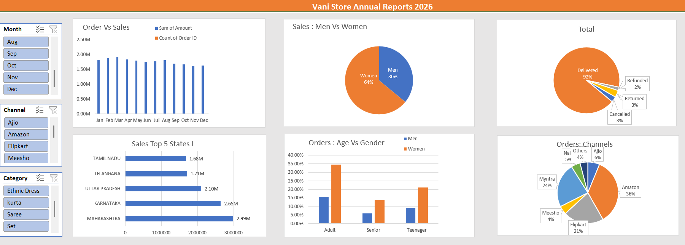

# Vani Store Data Analysis | Excel Project

## Project Overview
This project focuses on analyzing Vrinda Store's sales data using Microsoft Excel. The objective is to understand sales performance, customer demographics, order status, and sales channel performance through data analysis and dashboard reporting.

## Tools & Technologies
- Microsoft Excel
- Pivot Tables
- Pivot Charts
- Data Analysis
- Dashboard Visualization

## Dataset Description
The dataset contains sales and order information, including:
- Order ID and Customer ID
- Gender and Age Group
- Order Date and Month
- Order Status
- Sales Channel
- Product Category and Size
- Quantity and Amount
- Shipping City and State

## Key Performance Indicators (KPIs)

| Metric | Value |
|---|---:|
| Total Sales Amount | ₹2,11,76,377 |
| Total Orders | 31,047 |
| Highest Sales Month | March |
| March Sales | ₹19,28,066 |
| Women Sales | ₹1,35,62,773 |
| Men Sales | ₹76,13,604 |

## Analysis Performed

1. Monthly Sales Analysis
2. Gender-wise Sales Analysis
3. Order Status Analysis
4. State-wise Sales Analysis
5. Age Group and Gender Analysis
6. Sales Channel Analysis

## Key Insights

- March recorded the highest monthly sales.
- Women contributed more sales than men.
- Delivered orders were the largest order-status category.
- State-wise analysis helps identify important sales markets.
- Channel analysis provides insights into different sales platforms.

## Project Files

- `Dataset/` – Excel dataset
- `Dashboard/` – Dashboard screenshot
- `Report/` – Project report 

## Dashboard Preview

Add your dashboard screenshot here:

## Conclusion

This project demonstrates how Microsoft Excel can be used to analyze retail sales data, identify business trends, understand customer behaviour, and present insights through dashboard reporting.

## Author
Data Analytics Portfolio Project

